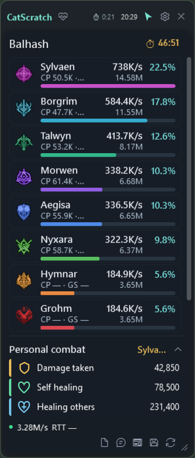
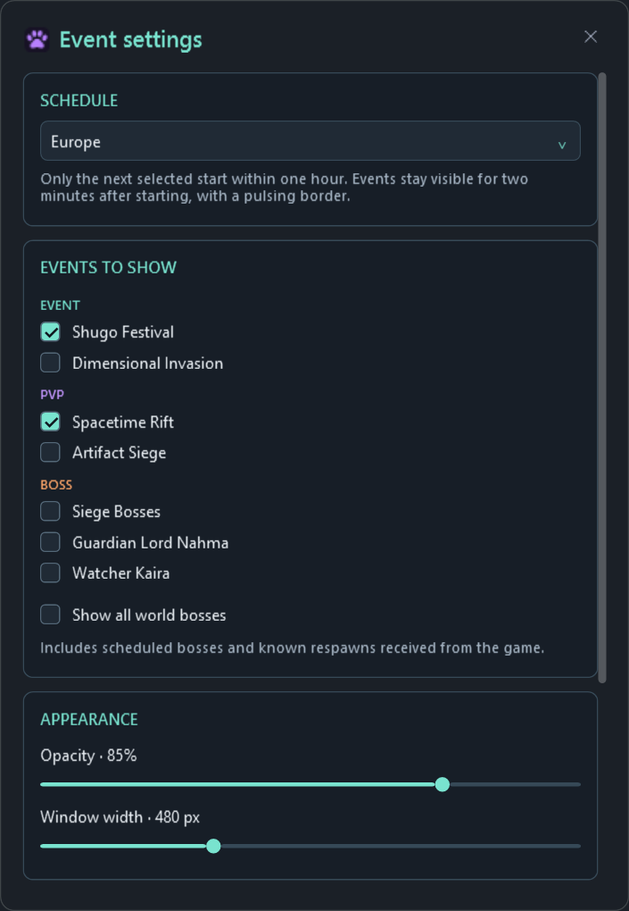

# CatScratch

A separate always-on-top Windows damage meter for AION 2 by Zerafithekitten.

## Preview

Actual CatScratch 2.1 UI, rendered with sample data. These images show the app's appearance; names and numbers are examples.

### DPS meter and Personal combat

### Click-through mode

The outer window background, borders and controls disappear; subtle dark player backgrounds keep names and numbers readable. DPS bars, personal values, clock and ping remain visible. The green backdrop below represents the game behind the transparent window.

### Narrow window

The meter can be resized down to 260 px wide. Long names and CP/GS labels shorten when space is limited; the footer adapts to keep its controls accessible.

### Fight details

### Settings and upcoming events

## Downloads

Get Setup or the portable ZIP from [Releases](https://github.com/Zerafithekitten/CatScratch/releases/latest).
Install once with Setup, or unzip the portable package. Both can update directly in the app.
Install [Npcap](https://npcap.com/#download) separately, start the meter and teleport once.
Normal startup requests administrator rights through Windows. If you cancel that prompt, the meter does not start.
Use borderless windowed mode to keep the meter visible above the game.

## Features

- Own damage while solo and confirmed current party members while grouped.
- Class, name, DPS, damage, share, Combat Power and Gear Score.
- Dark player rows with separate class-colored DPS bars, resizing, opacity and shortcuts recorded by pressing keys.
- Integrated, collapsible Personal combat showing your damage taken, self healing and healing of others.
- Click-through removes window frames while preserving damage, time and RTT.
- Movable event cards for the next selected start within an hour, with a pulsing border for two minutes after the start.
- Separate observed boss timers; optional fight saving, retaining the last ten saved fights.
- Colored EVENT / PVP / BOSS badges and readable boss panels when locked.
- Optional per-event sounds with preview, volume, reminder timing and custom WAV files.
- Patch notes available in the meter, including offline notes for the installed version.
- English interface and verified GitHub updates for installed and portable copies.

Use Settings > General > Updates > Check now to update from inside the meter.
CatScratch replaces its program files and restarts without running Setup. Its own userdata is preserved; failed file replacement restores backups. Updates need a writable program folder.
Existing Zerafi DPS Monitor installations use one final migration installer to switch the executable and shortcuts to CatScratch. The installation identity and userdata stay the same; the old GitHub URL redirects to this repository.
The main window's X exits the whole program, including event and boss windows.
The show/hide shortcut only changes visibility.

The meter passively captures traffic. No game-memory access, injection, game-file
changes, outgoing game packets or simulated game input are implemented.
This does not imply publisher approval. Incoming packets can contain other players;
the results are filtered to your confirmed character and party.

## Limitations

Missing server data can make damage incomplete. RTT is a passive TCP estimate;
a local accelerator can expose only its local connection. Events use bundled
community schedules from [Shugo.GG](https://shugo.gg/timers), checked Oct 12, 2026.
Global event times are not officially confirmed. Verify availability in game.

## Development

Requires .NET 10. See [GITHUB-RELEASES.md](GITHUB-RELEASES.md).
Version tags build the Windows app and installer and publish release downloads.
Packet recordings and userdata are excluded from Git and releases.

## License

GPL-3.0, based on [cyberbadger6969/aion2-dps-meter](https://github.com/cyberbadger6969/aion2-dps-meter),
base revision 414de5c1d5f3d45ce35701bd25229c2dba736bb6.
Keep LICENSE and data/NOTICE.md with redistributions. Full source accompanies releases.
AION 2 belongs to NCSOFT.
