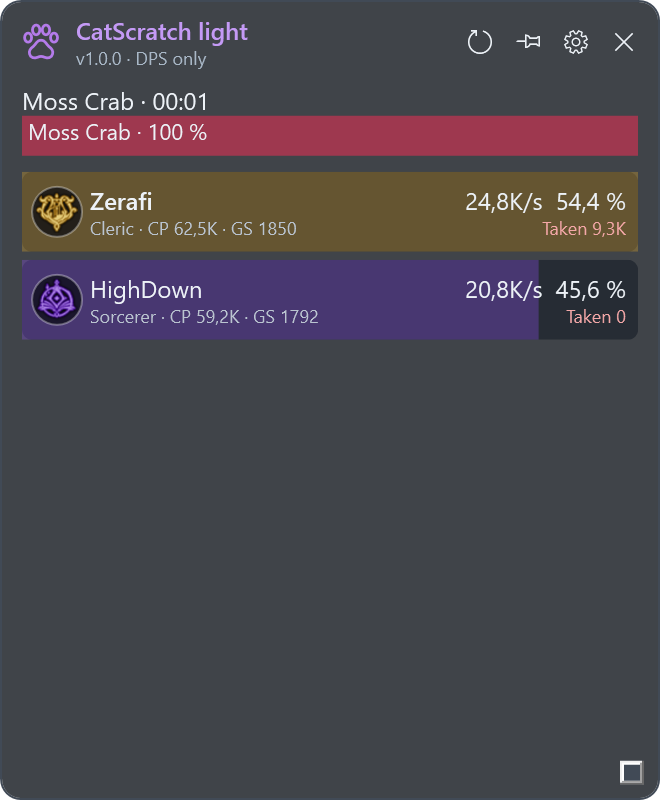

# CatScratch light

**Only the DPS meter.** A separate Windows download for AION 2, with the compact gray/lavender CatScratch style.

[Download CatScratch light 1.0.0](https://github.com/Zerafithekitten/CatScratch/releases/tag/light-v1.0.0) · [Full CatScratch](https://github.com/Zerafithekitten/CatScratch/tree/main)

## Included

- Passive AION 2 capture and automatic network-adapter selection, with a manual adapter override.
- Live DPS for your character and confirmed party members, percentage shares and incoming damage.
- Class emblems and class-colored full-row fills, CP/GS when confirmed, boss HP when available.
- Position pin, fight reset, compact embedded settings, window resizing and background transparency.

Light has **no** separate control panel, events, planner, pets, hidden-cube detection or alerts, boss-timer management, death-recap window, fight-history browser, boss comparisons, notifications, audio, game autostart, updater or telemetry. Its executable does not reference or ship the full application's UI assembly. Shared passive parsing and combat calculations are frozen at this branch's snapshot.

## Separate installation

1. Download **CatScratch-light-win-x64.zip** from the Light release.
2. Extract the **entire** ZIP into its own folder, separate from the full version. Do not copy it over a CatScratch installation.
3. Install [Npcap](https://npcap.com/#download) if needed. .NET is bundled.
4. Run **CatScratch.Light.exe** and accept the Windows administrator prompt for packet capture.
5. Teleport or change zones while it is running to confirm your character and current party. Use borderless windowed mode.
6. The gear opens essential settings inside the same DPS window. Save applies settings without closing it; the gear returns to the meter. X exits Light.

Settings are stored separately under **%LOCALAPPDATA%\\CatScratchLight\\settings.json**. It does not import or overwrite the full version's settings. No packet recordings or fight files are written. Game traffic and the damage the server sends determine what can be displayed; missing data is not invented.

## Maintenance and updates

The Git branch is **catscratch-light**. The full version remains the main development target.

**Light is changed, built or updated only when the owner explicitly requests work on Light.** Normal Stable/Beta changes are not merged automatically. Light has no automatic update checks or channel switch. New Light versions, when explicitly commissioned, are separate manual ZIP downloads with `light-vX.Y.Z` tags and do not replace the main Stable release.

## Development

Build `src/CatScratch.Light/CatScratch.Light.csproj` with .NET 10 on Windows. Run the executable with `--verify <result.json>` to check the standalone UI with synthetic events, without starting capture or touching user settings. The Light release workflow runs only when an explicit `light-v*` tag is pushed. Ordinary branch pushes do not publish Light.

Original credits and license remain in this repository.
