# CatScratch

A separate, always-on-top Windows DPS meter for **AION 2**, by Zerafithekitten. Track your own fights and confirmed party members in a compact dark gray interface with restrained purple accents and cat-paw branding.

[Download Stable](https://github.com/Zerafithekitten/CatScratch/releases/latest) · [Download CatScratch light](https://github.com/Zerafithekitten/CatScratch/releases/tag/light-v1.0.0) · [Release history](https://github.com/Zerafithekitten/CatScratch/releases) · [Report a bug / request a feature](https://github.com/Zerafithekitten/CatScratch/issues/new/choose)

| Channel | Current version | What it includes |
| --- | --- | --- |
| **Stable** | **[v3.0.11](https://github.com/Zerafithekitten/CatScratch/releases/tag/v3.0.11)** | Compact panel layouts, checklist with a custom hotkey, reset countdowns and stable click-through placement, Pet tracking modes and sounds, passive Hidden cube alerts, ONLY BOSS, defeat estimates, refined Test mode and DPS placement fixes. |
| **Beta** | **[v3.0.12-beta.20](https://github.com/Zerafithekitten/CatScratch/releases/tag/v3.0.12-beta.20)** | Optional Dungeon entries for Daily, Nightmare and Shugo; live Odyle, Abyss Points, Centuryroot, Phantasmal Fragment and Oath Coin updates, plus the previous Beta improvements. |
| **Light** | [v1.0.0](https://github.com/Zerafithekitten/CatScratch/releases/tag/light-v1.0.0) | Separate **DPS meter only** edition with essential settings. Independent ZIP download and settings; no additional CatScratch modules or automatic updater. |

**CatScratch light** is installed separately from the full version. [Download its ZIP](https://github.com/Zerafithekitten/CatScratch/releases/download/light-v1.0.0/CatScratch-light-win-x64.zip) and extract it into its own folder. Light is maintained and updated **only on the owner's explicit request**; normal development continues on full CatScratch.

English is the default. German, Russian and French are also available. Screenshots use synthetic sample data; names and numbers are examples. All features described below are included in **Stable v3.0.11** unless a limitation is stated.

## Contents

- [Getting started](#getting-started)
- [CatScratch control panel](#catscratch-control-panel)
- [DPS meter and fight details](#dps-meter-and-fight-details)
- [Group-search statistics](#group-search-statistics)
- [Permanent boss personal bests](#permanent-boss-personal-bests)
- [Last played with](#last-played-with)
- [Death recap](#death-recap)
- [Interface colors](#interface-colors)
- [Overlay profiles](#overlay-profiles)
- [Boss fight comparison](#boss-fight-comparison)
- [Fight selection and saved fights](#fight-selection-and-saved-fights)
- [Pet tracker](#pet-tracker)
- [Events, boss timers and sounds](#events-boss-timers-and-sounds)
- [Updates and release channels](#updates-and-release-channels)
- [Patchnotes](#patchnotes)
- [Help & symbols](#help--symbols)
- [Controls and shortcuts](#controls-and-shortcuts)
- [Automatic start and close with AION 2](#automatic-start-and-close-with-aion-2)
- [Languages and stream mode](#languages-and-stream-mode)
- [Debug recordings and feedback](#debug-recordings-and-feedback)
- [Limitations](#limitations)
- [Development and license](#development-and-license)

## Getting started

1. Download **CatScratch-Setup.exe** or **CatScratch-win-x64.zip** from your preferred release channel. Extract the entire portable ZIP to a writable folder.
2. Install [Npcap](https://npcap.com/#download) separately if it is missing. CatScratch can open the official download page for you.
3. Start **CatScratch.exe** and accept the Windows administrator prompt. Cancelling the prompt prevents startup.
4. Teleport or change zones once while the meter is running so it receives fresh character information.
5. Use borderless windowed mode to keep the overlay visible above the game.

Both Setup and portable installations support in-app updates. Your settings and local records are kept in `userdata` beside the program. The installed version appears underneath the CatScratch title in the separate control panel, which holds the module and general controls.

## CatScratch control panel

The permanent control panel holds the version, single Settings gear and general controls independently of the DPS display. It stays clickable during global click-through. Its X is the only in-app Exit action; auxiliary module close buttons only close their own window.

Choose horizontal or compact vertical orientation, nine screen anchors or free placement under **Settings > Appearance > Control panel**. The vertical layout uses four tight symbol columns with subtle separators. Panel position, alignment, transparency and pin state are saved independently and included in overlay profiles. The DPS position pin stays on the DPS display itself.

You can hide the combat display under **Settings > Appearance > Modules > Show DPS meter** and continue using Pets, events and capture. Restore the display from the panel, tray or its shortcut. The panel remains your direct Settings access point.

To retain click-through across restarts, enable **Settings > Appearance > Modules > Remember click-through after restart** and Save. CatScratch restores the last saved on/off state; the control panel stays clickable. The option is off by default and is independent of overlay profiles.

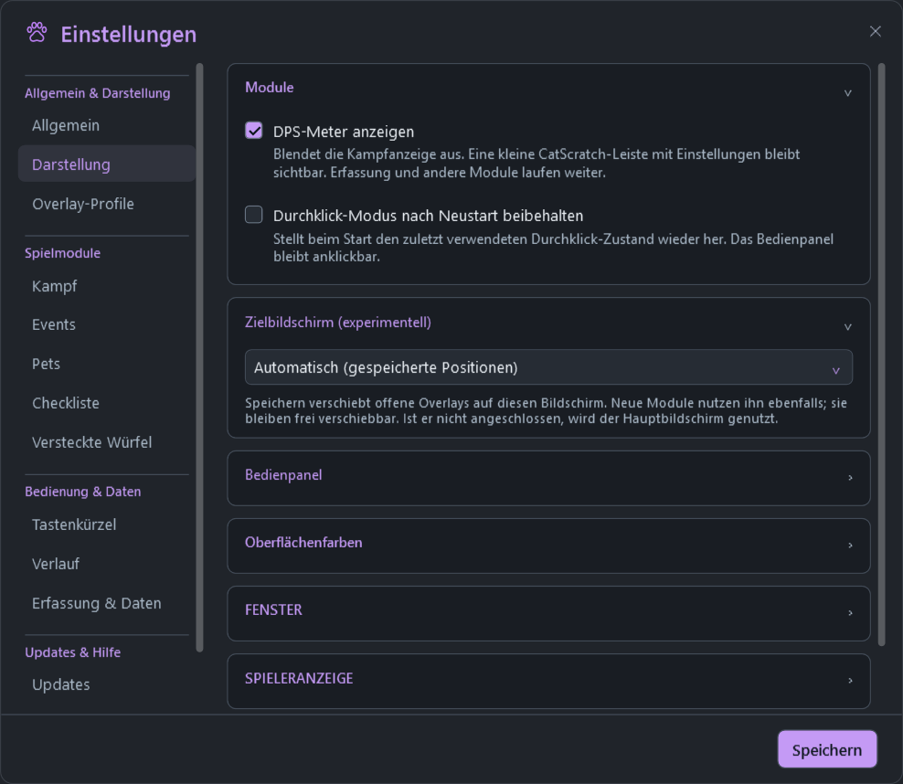

## DPS meter and fight details

The meter tracks your own damage while solo and confirmed current party members while grouped. Compact rows show class emblems, class-colored background fills, name, DPS, damage share, Combat Power (**CP**) and Gear Score (**GS**). Missing values appear as dashes. Incoming damage is shown separately in red.

The collapsible **Personal combat** section shows self healing and healing of others. An optional boss HP panel uses received health data. A small **Enrage time** bar appears only for a received deadline matching that boss; it represents the server boss time limit, not a predicted enrage mechanic. Enable **Settings > Combat > Separate boss timing window** to move Enrage time and Estimated defeat into their own compact overlay. It has a saved position and independent pin; turn the option off or use its X to return the displays to the DPS meter. It continues updating while the DPS display is hidden. In click-through mode the outer frame disappears; without an active boss, the idle timing overlay is fully transparent.

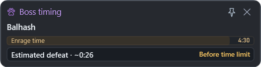

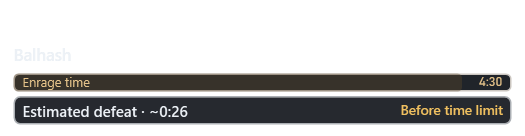

The control panel shows the Europe/Berlin clock and fight duration; the combat display footer retains party DPS and a passive RTT estimate.

**Effective self healing and healing of others.** Both personal-combat values count only HP gains confirmed by nearby health updates, excluding overhealing. Recognized direct group heals and healing-over-time ticks are supported. An asterisk marks an incomplete confirmed subtotal; a dash means healing occurred but none could be confirmed. Missing or ambiguous HP data, overlapping healers and concurrent damage are excluded rather than estimated. The tooltip explains the marker. Existing reported-healing fields in saved statistics and boss records retain their original meaning; the personal-combat display uses separate effective values.

Automatic fight-end detection is available in the combat settings. Resize the meter down to 260 px, adjust opacity and UI scale (75–150%), or switch between compact and normal layouts. Click-through hides the frame and controls while keeping statistics readable. Settings remain clickable.

Open a player's fight details for DPS, skills, accuracy, rotation and defense, with sorting, a timeline and chat/image export.

Fight details and click-through previews

## Group-search statistics

Before combat, the live meter can show the confirmed group-search room's members with their names, classes, CP and GS. No damage is required. An active fight takes priority, and completed fight results remain available through Statistics.

**Group-search reliability:** empty slots in the middle of a room no longer hide the players after them. New arrivals fill those slots without discarding the remaining members. Confirmed leave notifications clear the group even if the packet reader missed an earlier roster. CP/GS are kept separate for same-named characters on different servers, including after cache reloads.

Group information must actually arrive from the game. CatScratch cannot reconstruct a roster or values it never received.

## Permanent boss personal bests

Open the **small trophy icon** in the CatScratch control panel. Search the bundled catalog of real dungeon bosses and world bosses, including bosses for which you have no record yet.

Each boss retains **six independent best values**, separately for each character, server and class:

| Statistic | Better result |
| --- | --- |
| DPS | Higher |
| Total damage | Higher |
| Strongest hit | Higher |
| Healing done | Higher |
| Own deaths | Lower |
| Damage taken | Lower |

Each value can come from a different qualifying victory. Equal or worse results never replace a best. Values and achievement dates persist across restarts and updates, independently of saved fights: **there is no ten-record limit for boss bests**.

A record requires a confirmed real boss kill, usable own-character data, a known starting HP baseline and boss-only outgoing damage. Test mode, recorded playback and incomplete or unqualified fights do not improve personal bests. Missing packets can prevent qualification or omit observed events.

Boss personal bests preview

## Last played with

Open the **player icon beside the trophy in the control panel**. The local list keeps confirmed teammates, newest first, separately for each own character/server.

Compact rows show name, class, server, last-played time and the last received **CP / GS**, without expandable equipment panels. Every player has an individual **copy-name button**. Repeated appearances update an existing entry rather than adding duplicates. The list persists across restarts and has no ten-player limit.

Unknown CP/GS remain dashes until usable values arrive; missing values do not erase known values. Stream mode masks displayed and copied names consistently. Test mode and recorded playback do not populate the permanent list.

## Death recap

The **tombstone icon** enables or disables the module. When your character dies, a compact recap shows only the five latest received hits from the previous **ten seconds**, newest first, with attackers, skills, time before death, red damage values and their matching total. It opens centered in the upper half of the meter screen, above the standard resurrection controls, and remains movable.

It closes when fresh positive own HP or a map reload confirms the character is alive. Same-map resurrection and batched HP updates are supported. The default toggle is **Shift+F4**, configurable in Settings > Hotkeys. The recap is temporary and is not retained after restarting CatScratch.

## Interface colors

**Available in Stable.** Settings > Appearance > Interface colors lets you choose accent, background and text colors using a saturation/brightness field, a rainbow hue strip, swatches or #RRGGBB. The preview is a draft: Save applies the colors across open windows and keeps them for the next start; Closing with X discards later unsaved palette edits. Restore default colors returns to the gray/lavender CatScratch palette after Save. Low contrast is shown as advice and does not prevent saving a valid color choice. For a small Easter egg, the **?** beside Restore default colors enables **Mario Party!**: a continuous rainbow wallpaper scrolls across the general window backgrounds in a seamless 12-second loop after Save, including after restart. Restore default colors and Save stops the mode. Class, healing, damage, event-type and golden favorite colors keep their meaning; the purple paw stays unchanged.

Color settings and picker previews

## Overlay profiles

Use **Settings > Overlay profiles**. Arrange the modules first, enter a name and choose **Save new profile**. Use **Apply profile**, **Update selected** or **Delete selected** to manage layouts. Applying acts immediately and closes Settings, discarding any unsaved edits in other tabs.

Profiles retain meter and module placement, open states, position pins, UI scale, opacity, row size and display choices. Capture, update channel, hotkeys, autostart, event schedules and sounds stay unchanged. Profiles are optional and switch only when you apply one. Death recap keeps its automatic upper-center default.

## Boss fight comparison

Open a finished boss fight from Statistics or saved history and use **Boss fight comparison** in its statistics header. The last earlier matching recorded fight is compared automatically. Both run cards show the boss name prominently, with date and duration beneath; no manual fight list or technical identifiers. The DPS meter remains Live.

The table compares your duration, DPS, damage, healing, damage taken and deaths with signed differences (current minus previous). Matches require the same boss, map ID, character/server/class, outcome and damage mode. Possibly partial recordings are flagged and unknown deaths remain unknown. Difficulty variants without different map IDs cannot be distinguished.

Comparisons use existing session fights and the ten saved fights. Save boss fights to retain them after restarting; this feature does not turn on automatic saving or change permanent boss bests.

## Fight selection and saved fights

Use **Statistics** for the live fight, current-session fights and **All saved fights**. Selecting an earlier session or saved fight opens its detailed statistics immediately in a separate window, starting with your own character when available. The DPS meter stays on **Live** throughout; opening history never replaces its current fight or room stats. Repeated clicks on the same fight reuse its statistics window. Boss bests and recent teammates have their own buttons; they are not duplicated in Statistics or Feedback.

Saving is optional. Press the **save button after combat** to keep a full fight. The saved-fight history retains the **ten newest saved fights**. This limit applies to full fight records only, not permanent boss bests or recent teammates. Automatic saving is disabled by default.

Fight selection preview

## Pet tracker

**Settings > Pets** contains the pet module toggle, width and collection/level-up sound option. Save applies changes while Settings stays open; closing with X discards later unsaved edits; the pet overlay has a position pin instead of a settings gear.

Use the **paw button in the control panel** to toggle the compact pet tracker. With confirmed collection data, the module recommends up to five incomplete pets in the current supported region without an attack. Freshly observed, confirmed source monsters take priority and mark their pets with **⌖**. Region recommendations cover Verteron, Altgard and Chaotic Lower Reshanta; completed pets are excluded. The compact list scrolls and shows soul progress toward the next level. If no supported region or nearby source is known, the last three personally attacked incomplete pets remain available as a fallback. Completed pets are hidden in every view and disappear as soon as their final soul loot confirms level 3. Soul loot updates the count after a kill.

Progress is saved per character. A **~** prefix marks last-known counts until fresh login data arrives. If no baseline is saved, log into the character once while CatScratch is running; opening an already cached pet menu may not resend the collection. Recent completed local recordings can help recover a missing baseline.

The bundled catalog contains confirmed Global monster-source mappings for 165 pets and locally stored community map locations for 156 matched pets, attributed to [AION 2 Pets / Wikily](https://aion2pets.app/map/). Recommendations use received map IDs and fresh monster announcements, not a scan of game memory. Map-pixel coordinates have not been validated against live player coordinates: no exact distances, navigation arrows or player radar are displayed. A regional recommendation means a recorded farming source in that region, not a guaranteed nearby spawn or soul drop. Region changes and capture resets clear old location context. Unknown collection progress stays unknown; **~** marks cached progress.

Pet tracker preview

## Events, boss timers and sounds

Use the **single gear in the control panel > Events** for event visibility, region, selection, module widths, opacity, boss reminders and all event sounds. Event modules no longer have their own gear. Use Save to apply these options while Settings stays open; closing with X discards later unsaved edits; sound previews and custom audio selection stay inside the same Settings window.

Selected events and enabled world-boss timers within the next hour appear as compact movable cards. Both modules restore their own positions and open states.

The CatScratch control panel is the single taskbar entry; display modules do not add separate taskbar/Alt-Tab entries or native Windows Snap frame styles. Each display module has a matching position pin at the upper right. Pinning prevents dragging without changing button interaction or click-through. Pin states survive restarting and are stored with optional overlay profiles; unpin to move a module again.

**Upcoming and Started are separate.** At the start, an entry leaves Upcoming and moves into the movable **Started events** module. Enable that module in Settings > Events; drag its header or cards to place it, and use its X to close it. Click-through and show/hide all windows work for both modules.

| Started entry | Text | Visibility |
| --- | --- | --- |
| Event | **Open!** + remaining countdown | 3 minutes |
| Spacetime Rift | **Open!** + remaining countdown | 10 minutes |
| Boss | **Spawned**, no countdown | 2 minutes |

**24-hour timeline.** The clock in Upcoming opens a horizontal planner with a separate track for each event. It shows all scheduled event types in the selected region and known next world-boss spawns. Star an event to persist it as a favorite: its timeline markers and matching overlay cards receive a thin, softly glowing gold frame. Favorites do not change overlay selection or reminder sounds. Events are turquoise, PvP lavender and bosses orange. Times use the selected region, including daylight-saving changes. The planner refreshes automatically every minute while open and immediately when reopened. It uses the bundled community schedule, rather than fetching live schedule changes; event times are not officially confirmed.

Expired entries disappear automatically. While an event is active, a later recurrence with the same name is held out of Upcoming; its next start returns after the active entry expires.

Boss timers are separate from personal boss bests. They use received in-game boss-list data and observations; estimated intervals remain identified as estimates.

Optional per-event and pet unlock/level-up sounds support preview and volume settings. Custom **WAV / MP3** files must be at most **10 seconds and 10 MB**. The chosen filename is displayed; **Change audio…** replaces it. Invalid selections show an inline error and keep the previous sound.

Events, boss timers and sound settings

## Target screen (experimental)

Under **Settings > Appearance > Target screen (experimental)**, choose the monitor for CatScratch. **Save** moves the control panel and open overlays to it. New modules and Settings also open there; windows remain freely draggable. The choice survives restart and is independent of overlay profiles. **Automatic (saved positions)** keeps existing placements; an unavailable chosen monitor falls back to the primary screen.

## Checklist

Use **Shift+F3** (customizable in **Settings > Hotkeys > Checklist**) or the **Checklist button in the control panel** to show or hide it without changing task text or checkmarks. Its icon is highlighted while enabled and is explained in **Settings > Help & symbols**. You can also enable **Settings > Checklist > Show checklist**, select **1–20 task slots** and a window width, then **Save**. The module has a transparent outer surface and compact tinted rows. Type a task on the right and use its checkbox on the left to strike it through; uncheck it to undo completion.

Text and checkmarks save automatically and survive restarting CatScratch. Reducing the number of visible rows keeps hidden tasks. Small **Daily** and **Weekly** headings separate the eleven editable examples: two daily and nine weekly tasks from the supplied overview. Category prefixes are omitted from the task rows; extra free slots appear under **Other tasks**. These are sample text, not automatic progress detection. Reset countdowns and opt-in clearing are described below.

The module has its own pin and X. Checkboxes remain clickable in global click-through mode without taking game keyboard focus. Task text and empty space stay click-through; unlock the mode to edit text. Hiding the title controls keeps every task at the same screen position. Layout profiles change placement, width and slot count without overwriting task text or completion. Checklist is part of full CatScratch only.

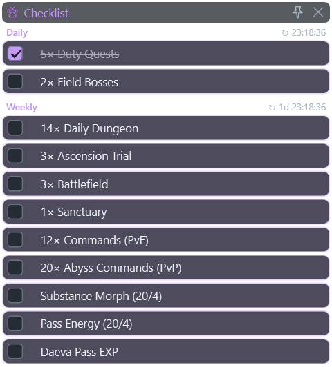

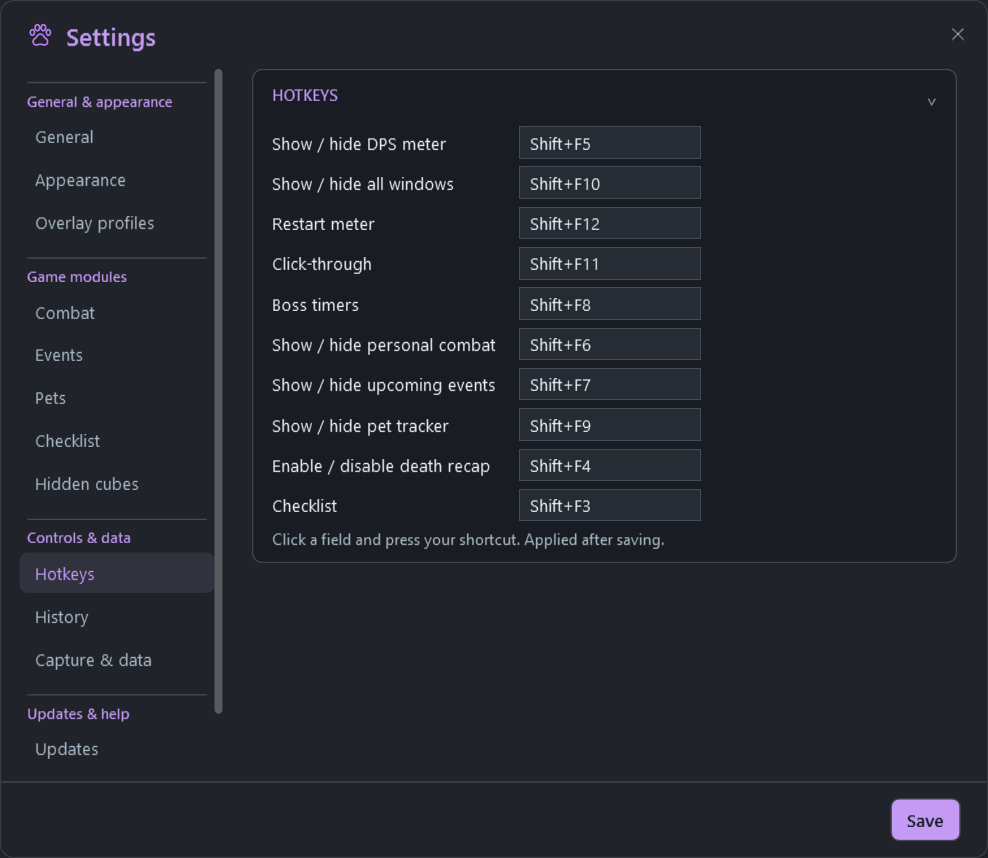

## Hidden cubes (experimental)

Enable **Settings > Hidden cubes > Enable hidden cube alerts (experimental)** to show a compact, movable **HIDDEN CUBE DETECTED** warning for the cube type confirmed in two recordings. The module is off by default. It supports an independent pin, click-through, saved position and overlay profiles. The warning uses bold red text with gently pulsing exclamation marks. **Show test alert** lets you position and pin a labeled preview even without a detected cube; closing Settings also closes the preview.

Choose an optional **MP3 or WAV** in the same tab, adjust its independent **Volume**, and use **Preview** to listen before saving. One notification plays for each newly detected cube, rather than every repeated announcement. Visual test alerts stay silent. Files must be at most **10 seconds / 10 MB** and remain at their selected location.

Opening the cube or changing context clears the warning; announcements also expire after 60 seconds without a refresh. An announcement confirms that the server sent the object, rather than a measured distance or continued visual presence. Other cube variants, map placement, direction and distance remain unverified. No screenshot capture or game-memory access is used.

### Overlay recovery and startup (Beta 3.0.12-beta.2)

**Beta only.** Topmost recovery has an independent refresh loop and periodic native repair. It does not move or reveal hidden windows, or take keyboard focus. Settings and interactive CatScratch dialogs remain usable.

The existing restart preference is now labeled **Settings > Appearance > Modules > Start with click-through enabled**. With it enabled, startup activates click-through even if the previous session temporarily unlocked it. Existing enabled preferences carry over. Event modules no longer switch global click-through off when opened; unlock explicitly from the panel, shortcut or tray.

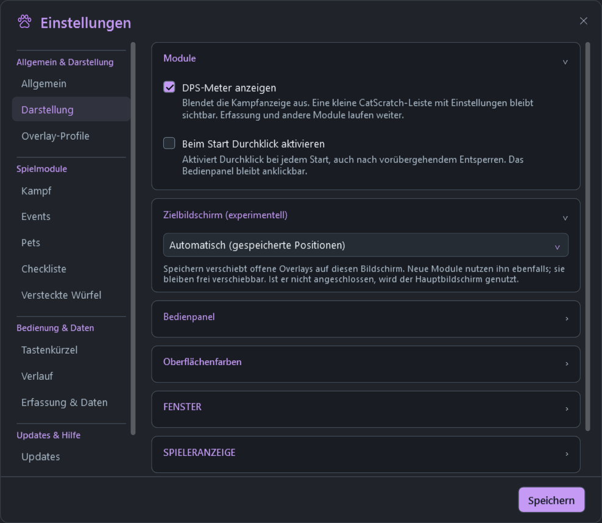

### Individual world bosses (Beta 3.0.12-beta.1)

**Beta only.** Settings > Events provides individual choices for known world bosses, a search field, favorite stars and an expandable sound picker for each boss. Favorites and selected bosses remain visible in the event modules beyond one hour; unknown times stay labeled as unknown. Confirmed living bosses appear in Started events. Favorites use the gold frame. Open a map's boss list in the game to discover additional world bosses.

Per-boss sounds support the existing built-in choices and validated WAV/MP3 files. They use the event reminder lead time and volume, only the current server's known respawn, and notify once per occurrence. Settings are drafts until Save. Display choice, favorites and sounds survive restart.

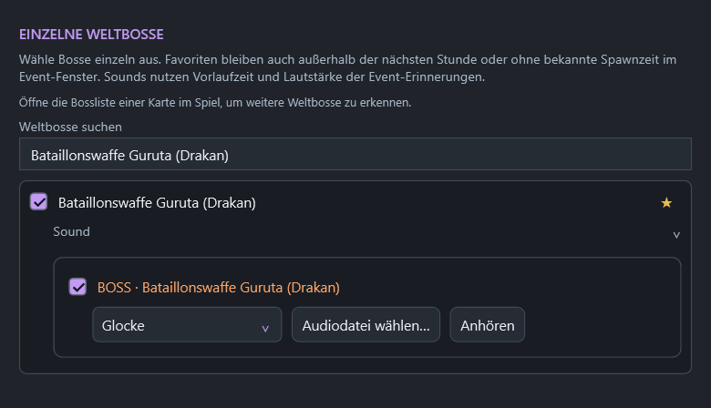

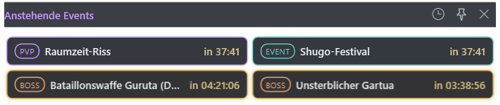

## Updates and release channels

Choose **Stable** or **Beta** in **Settings > Updates**. Stable is the default download; beta releases are marked as prereleases and do not replace it. Switching channels may offer an older version when returning to Stable.

With automatic updates enabled, CatScratch checks shortly after startup and **every ten minutes**. It downloads, verifies and extracts an available update in the background while the current meter keeps running.

The green **Update!** button appears **only after the update is fully prepared**, replacing the CatScratch title inside the existing control panel. Otherwise the normal CatScratch title remains visible. There is no separate notification window, and the panel position and dimensions stay unchanged. The installed version remains underneath. Horizontal, Vertical rail and Grid are supported. Click it to apply the prepared files and restart; CatScratch does not restart automatically.

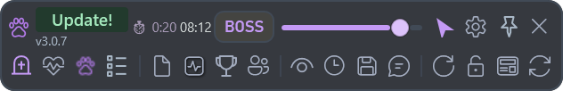

After a successful new startup, the old backup, staged payload and downloaded ZIP are removed. Failed updates retain recovery files. Settings, saved fights, personal bests, recent players and captures are preserved. Update staging stays under `userdata/temp/updates`; a writable program folder is required.

When a Beta is promoted and its Stable build starts, Beta subscribers automatically return to the Stable update channel. A later deliberate switch back to Beta is respected until the next Stable transition. The installed version then shows the Stable number, currently **3.0.11** without a beta suffix.

Use **Check now** in Settings or **Check for updates** in the tray menu for a manual check. Automatic checking and preparation can be disabled in Settings. CatScratch also reduces data-loading allocations and moves optional startup work behind the first meter display.

## Patchnotes

Open **Patch notes** from the control panel or Settings. Versions are listed **on the left**, newest first. Each version shows only its own changes, with a **clickable contents overview** above detailed explanations. Repeated older notes in cumulative release bodies are omitted from that version's view.

**The last ten versions are available.** The version sidebar is scrollable when space is limited. Stable shows Stable releases; the Beta channel also includes beta versions. Bundled notes work offline; **Refresh from GitHub** updates the history.

[Read all published release notes](https://github.com/Zerafithekitten/CatScratch/releases).

## Help & symbols

Settings > Help & symbols explains the panel and module icons, their functions and states, using your saved shortcuts. The guide is read-only and available in English and German.

Settings > Appearance > Control panel offers compact horizontal and vertical layouts, nine screen anchors and free placement. The panel can reach the full screen edge and follows display/background opacity. Dragging switches to free placement. Save applies changes while Settings stays open; closing with X discards later unsaved edits. Layout and alignment are included in overlay profiles.

## Controls and shortcuts

**Optional DPS display.** Settings > Appearance > Modules > Show DPS meter hides combat statistics while capture and other modules continue. The permanent CatScratch control panel contains the version and general buttons, keeps Settings directly available, and provides a DPS display toggle even with global click-through enabled. Its X is the only in-app Exit action. Panel and meter have independently saved placement and pins. The tray icon and configured DPS meter shortcut (Shift+F5 by default) also restore the meter. The choice persists across restarts and is included in overlay profiles. Automatic visibility and Show/hide all respect a disabled display.

The single control-panel gear opens central Settings. Updates and Feedback have separate tabs; General contains test mode, language and the optional game companion. Event and pet options apply with Save while Settings stays open; close with X to discard later unsaved edits.

Record a combination in **Settings > Hotkeys** and save. Defaults:

| Action | Shortcut |
| --- | --- |
| Toggle death recap | **Shift+F4** |
| Show/hide DPS meter | **Shift+F5** |
| Toggle Personal combat | **Shift+F6** |
| Upcoming events | **Shift+F7** |
| Boss timers | **Shift+F8** |
| Pet tracker | **Shift+F9** |
| Show/hide all windows | **Shift+F10** |
| Toggle click-through | **Shift+F11** |
| Restart meter measurement | **Shift+F12** |

The all-window shortcut restores the previously open windows and their positions. App shortcuts pause while Settings is active. The main window's **X exits the entire program**; show/hide shortcuts only change visibility. The tray menu remains available in click-through mode.

Settings preview

The Settings sidebar groups related pages under **General & appearance**, **Game modules**, **Controls & data** and **Updates & help**, with clear headings and dividing lines. The topic order stays consistent in all four languages.

## Automatic start and close with AION 2

**Purpose:** CatScratch can be ready whenever you play, without remembering to open it first. When the game closes, the meter closes too. Only a small game watcher stays idle between sessions; the full meter and packet capture do not need to stay running all day.

### Enable or disable it

In **Settings > General > AION 2 companion**, enable **Start and close CatScratch with AION 2**, select the actual **game EXE** and save. This is a single combined option and is **off by default**. Steam, Purple and shortcuts work because detection follows the selected game executable, independently of the launcher.

When enabled, a Windows Task Scheduler entry named `CatScratch-Game-…` starts the watcher at Windows sign-in. It also starts immediately when you save the option. The watcher checks every two seconds, opens CatScratch once per game session and CatScratch closes after ten seconds without the game. Brief game restarts reset that grace period. If you manually quit the meter, it stays closed until the next game session.

Turn the option off and save to remove the scheduled task and let the watcher exit. This does not close the game. Uninstall also removes the registration. No watcher is registered while this option is off.

### Why PowerShell is used

PowerShell provides the small Windows background check that remains available while CatScratch itself is closed. Its job is to detect the selected game and launch the meter. The DPS meter, its interface and combat calculations still run in CatScratch itself.

This keeps the watcher separate from the program files that an update replaces, so it does not lock the running meter's binaries or prevent background update preparation. It also avoids installing a permanent Windows service or requiring the entire meter and capture engine to run while you are not playing.

### What runs and what it checks

- The local watcher checks process names, executable paths and the current Windows session, and checks whether the meter is already running. It never starts or stops AION 2 itself.
- The watcher does not capture game traffic, download updates, upload files, read chat or ask for account credentials. Network capture and normal update checks belong to the meter after it starts.
- The task runs for the signed-in user with the highest available privileges, matching CatScratch's existing administrator requirement. It does not create a SYSTEM service or store your Windows password.
- The shipped local script uses `-ExecutionPolicy Bypass` for its own PowerShell process. CatScratch does not change the machine-wide PowerShell execution policy. Managed Windows restrictions may still prevent it from running; failed setup is reported rather than silently enabling the option.
- Scripts and configuration are kept locally in `userdata/game-start`. You can inspect the [watcher source](https://github.com/Zerafithekitten/CatScratch/blob/v3.0.1/src/AionMeter.App/Services/GameLifetime.cs) and [windowless launcher source](https://github.com/Zerafithekitten/CatScratch/blob/v3.0.1/src/AionMeter.App/Launcher/GameWatcherLauncher.cs).

### Why no PowerShell window should appear

CatScratch uses a tiny windowless starter that creates PowerShell with **CreateNoWindow**. The watcher remains in the background without allocating a console window, including the brief console flash possible with the previous direct PowerShell startup. Existing enabled installations switch to the quiet task when the updated meter first starts. Automated checks verify that the watcher has no console window.

## Languages and stream mode

Select **English, Deutsch, Русский or Français** in **Settings > General > Language**. Skill and monster names use bundled language tables, with English fallback where translations are missing. Patchnotes remain in English.

**Stream mode** replaces displayed and copied player names with consistent aliases such as Cat 1, Cat 2 and Cat 3. Original names remain in local saved records and packet captures; stream mode does not anonymize those files.

Test mode provides isolated sample fights and pet progress. Test fights cannot be saved as real fights and do not improve permanent boss records or add recent teammates.

## Debug recordings and feedback

Enable **Recent debug buffer** in **Settings > Capture & data**. **Save recent debug** exports up to the preceding **60 seconds** to `userdata/captures`. The buffer is disabled by default and capped at 32 MB of accounted packet storage; heavy traffic can shorten the available time. Continuous packet recording is also available. **Open captures folder** opens the recording directory directly from this section, creating it if needed.

Only packets received while recording is enabled can be saved. For group issues, include the actual join/leave; for resurrection issues, include death and revival. Short captures can lack earlier character or protocol context. Captures can contain character names; keep them private. Nothing is uploaded automatically.

Use **Report a bug / request a feature** in Settings > Feedback, or [open an issue](https://github.com/Zerafithekitten/CatScratch/issues/new/choose). Reports must be in **English**; a GitHub account is required. Please include the version/channel, what happened and how to reproduce it. Feedback opens GitHub without sending logs or captures automatically.

Capture and recording settings

## Limitations

- Pet suggestions use sight and supported regions, not measured proximity. Missing map or collection data remains unknown; the tracker does not read game memory or provide exact own-player distances.
- Missing or unreceived server data can leave names, CP/GS, damage or deaths incomplete. The meter filters results to your confirmed character and party, rather than displaying every nearby player.
- Death recap needs fresh health or map data to confirm revival. Two recorded resurrection paths have been tested; a third method still lacks a supplied recording.
- RTT is a passive TCP estimate. Delayed acknowledgements and local accelerators can affect it or expose only a proxy connection.
- Event schedules are bundled community data from [Shugo.GG](https://shugo.gg/timers), not an official confirmation of Global event times. Verify availability in game.
- CatScratch passively captures traffic. It does not implement game-memory access, injection, game-file changes, outgoing game packets or simulated game input. This does not imply publisher approval.

## Development and license

Requires **.NET 10**. See [GITHUB-RELEASES.md](GITHUB-RELEASES.md) for release builds and [INSTALL.txt](INSTALL.txt) for installation and controls. Version tags build and test the Windows app and installer. Packet recordings and userdata are excluded from Git and release archives.

**GPL-3.0**, based on [cyberbadger6969/aion2-dps-meter](https://github.com/cyberbadger6969/aion2-dps-meter), base revision `414de5c1d5f3d45ce35701bd25229c2dba736bb6`. Keep [LICENSE](LICENSE) and [data/NOTICE.md](data/NOTICE.md) with redistributions. Full source accompanies releases. AION 2 belongs to NCSOFT.

### Compact control panel (Stable 3.0.4)

Choose Horizontal, Vertical rail or Grid in Settings. Buttons are grouped by function with fine separators. The vertical rail uses upright stacked lettering and omits the clocks. Its mode label is fully visible and centered; Grid remains a separate option.

 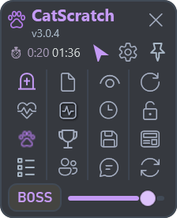

### Reset countdowns, module previews and strict boss measurement (Stable 3.0.4)

The checklist shows the next Daily and Weekly reset. Configure the UTC hour and weekly day in Settings > Checklist (defaults: 07:00 UTC, Wednesday). Verify these defaults for your server. Automatic clearing is off by default. When enabled, only the checkmarks of daily slots 1–2 and weekly slots 3–11 are cleared at their respective resets, including after an offline period. Custom task text and Other tasks are retained.

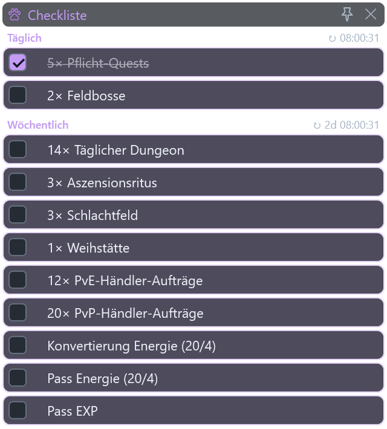

Settings > General > Start test mode opens seven screen modules plus Statistics and Boss comparison using isolated sample data. Existing user positions are preserved; DPS and Settings keep their dimensions, and Settings stays in place. Only modules without a known position get available space. Previews are clickable and movable. Other menus stay closed. Stopping Test mode restores previously visible real windows and the selected click-through mode without overwriting real tasks or permanently enabling modules.

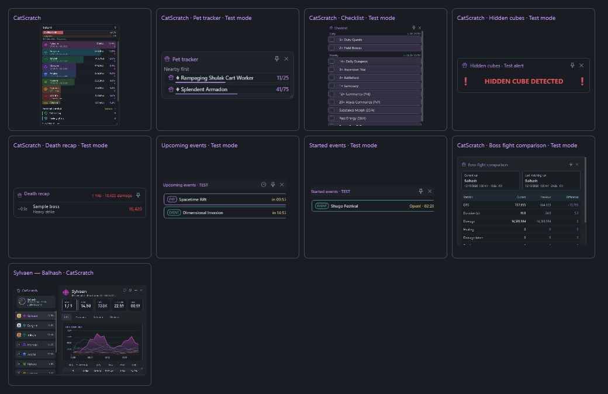

Settings > Combat offers **ONLY BOSS** alongside the existing BOSS fallback and ALL modes. The panel labels this strict mode **ONLY**. It counts only the concrete engaged boss, excluding adds and other boss actors; switching modes starts a fresh measurement. Boss defeat estimates use rolling observed boss HP loss, so add damage does not inflate the estimate. Insufficient or stale HP data shows Calculating. A matching server deadline permits a time-limit comparison, without claiming a confirmed enrage mechanic.

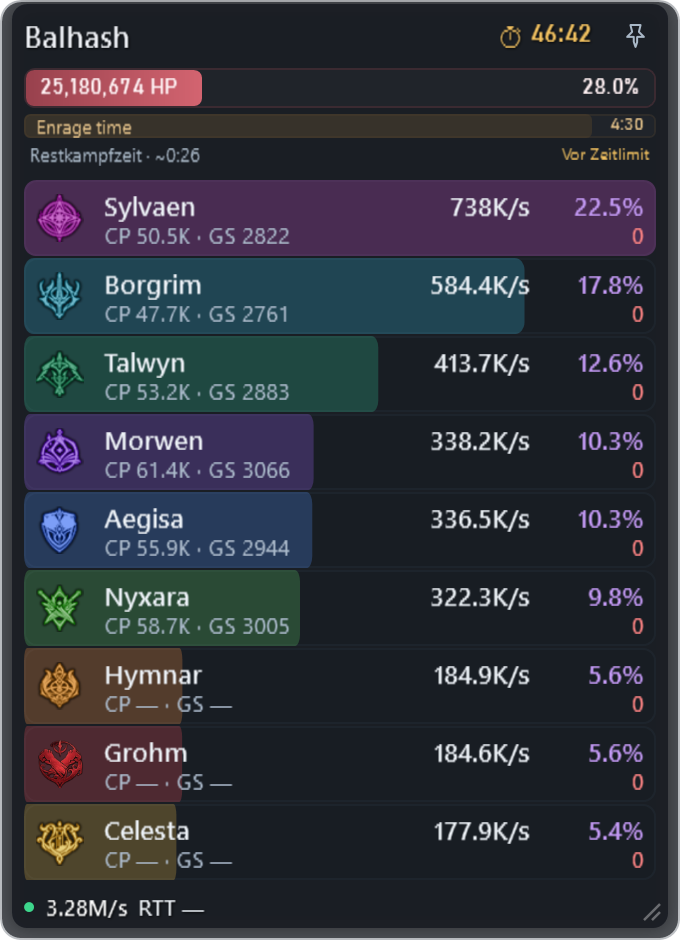

Stable 3.0.4 also fixes the DPS overlay moving upward on restart by using the same screen bounds during startup and dragging. If an older version saved an already shifted position, move the overlay back once after updating.

Stable 3.0.5 localizes checklist reset weekdays to the selected CatScratch language. English reset times and tooltips use AM/PM; German, Russian and French retain 24-hour times. Saved reset values remain unchanged.

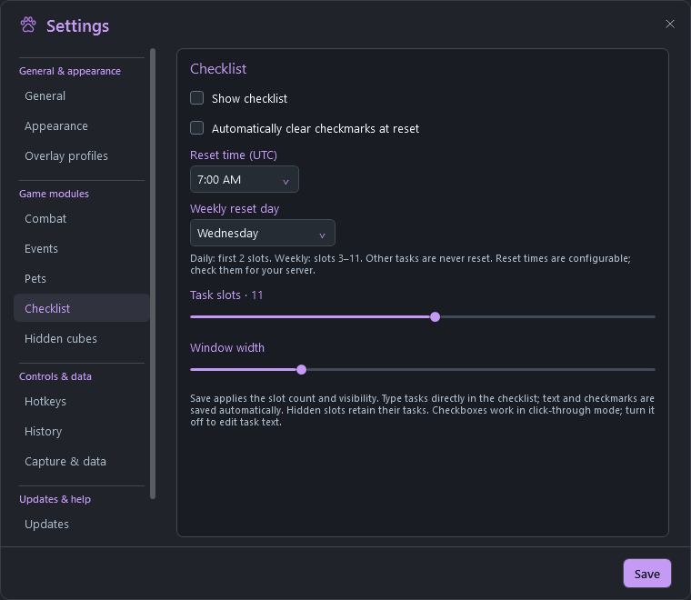

Stable 3.0.6 improves the boss defeat estimate in click-through mode: a dedicated dark surface, brighter semibold text and slightly larger lettering keep it readable over the game. The time-limit comparison retains its semantic colors.

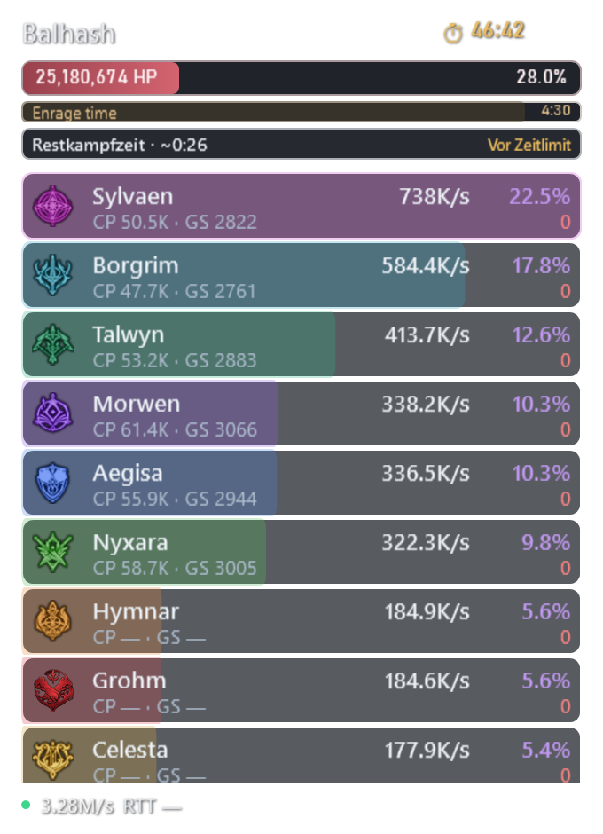

**Beta 3.0.12-beta.3:** World bosses are added to Watched only with the bell. Neither detected kills nor manual kill entries enable watching; kill times, respawn timers and existing watch selections remain saved.

### Resources module (Beta 3.0.12-beta.9)

Enable it in **Settings > Resources**, choose any of the five individual rows and adjust the width. The compact display is movable, pinnable, supports global click-through and show/hide, and saves its placement. Odyle Energy shows available (+supplementary) values, using confirmed login, regeneration and item-use packets. Capacity and the next recharge time are not inferred.

Abyss Points, Centuryroot Token, Deava Pass Shop Coin and Phantasmal Fragment show the last unambiguous received inventory balance, marked **\***. Continuous currency-change updates are not yet verified. Missing or ambiguous values show a dash; return to character selection and log in again to refresh the snapshot. No resources are read from game memory.

Resource layouts (Beta 3.0.12-beta.10): choose **List**, **Horizontal** (icons and values, names in tooltips) or **Grid** (two columns) in Settings > Resources. All five resources have bundled game icons, also shown beside their Settings choices. Horizontal width fits the selected values automatically; List and Grid use the width slider. Layout choices are saved and included in overlay profiles.

Missing resource data now displays an orange **Relog!** warning in all three layouts, with a tooltip explaining character selection and login. Confirmed zero balances remain visible as zero; received values replace the warning.

Beta 3.0.12-beta.20 fixes resource state preservation during login: incomplete character records, later server identification and unrelated/partial inventory messages no longer erase received balances. Confirmed character changes and capture resets still discard old values. This does not add active server queries or verified live currency spending updates.
