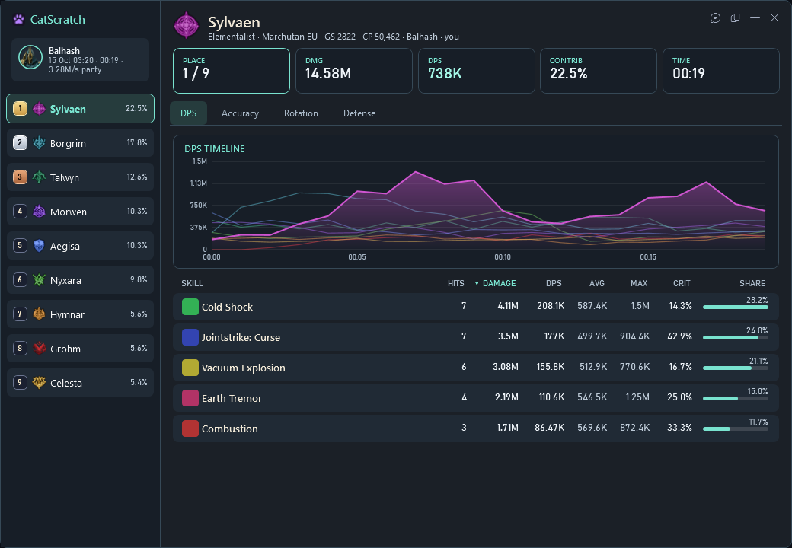
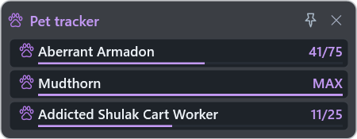
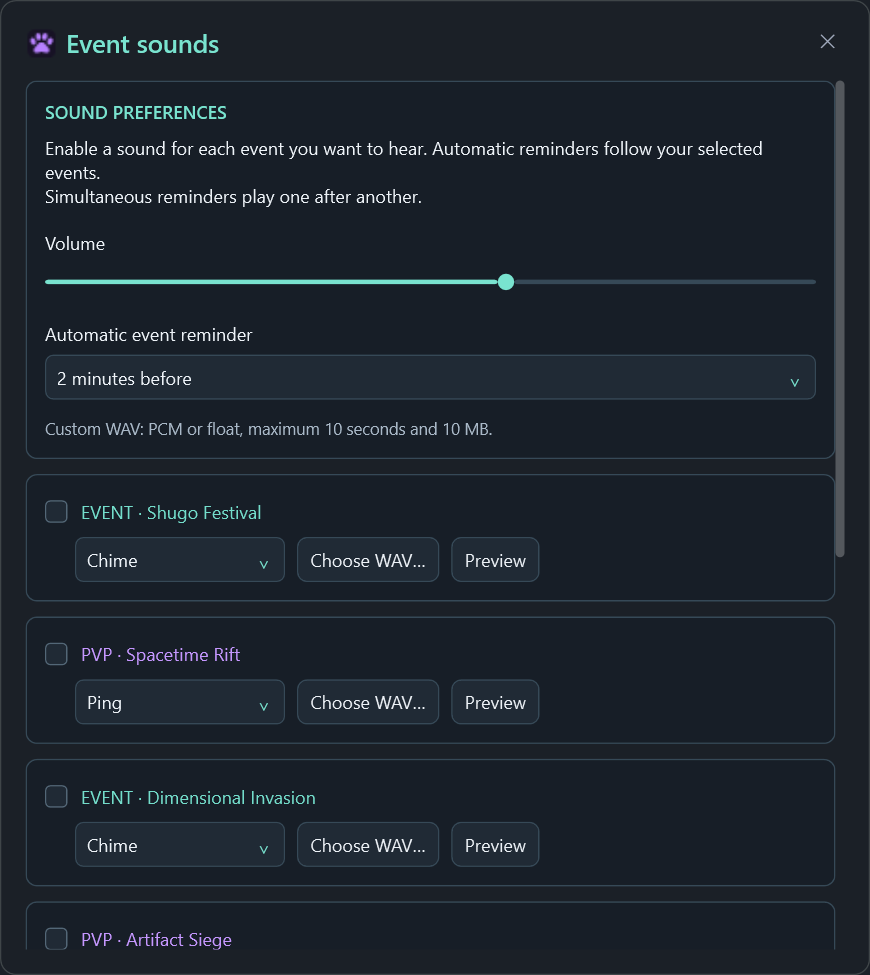

# CatScratch

A separate, always-on-top Windows DPS meter for **AION 2**, by Zerafithekitten. Track your own fights and confirmed party members in a compact dark interface with turquoise accents and purple paw branding.

[Download Stable](https://github.com/Zerafithekitten/CatScratch/releases/latest) · [Download Beta](https://github.com/Zerafithekitten/CatScratch/releases/tag/v2.5.6-beta.4) · [Release history](https://github.com/Zerafithekitten/CatScratch/releases) · [Report a bug / request a feature](https://github.com/Zerafithekitten/CatScratch/issues/new/choose)

| Channel | Current version | What it includes |
| --- | --- | --- |
| **Stable** | **[v2.5.5](https://github.com/Zerafithekitten/CatScratch/releases/tag/v2.5.5)** | Boss personal bests, recent teammates, death recap, background updates, separate Started events, improved group-search handling and ten patchnotes tabs on the left. |
| **Beta** | **[v2.5.6-beta.4](https://github.com/Zerafithekitten/CatScratch/releases/tag/v2.5.6-beta.4)** | Everything in Stable, plus an optional automatic start/close companion for AION 2. |

English is the default. German, Russian and French are also available. Screenshots use synthetic sample data; names and numbers are examples. Event-module previews show **v2.5.4-beta.4**.

## Contents

- [Getting started](#getting-started)
- [DPS meter and fight details](#dps-meter-and-fight-details)
- [Group-search statistics](#group-search-statistics)
- [Permanent boss personal bests](#permanent-boss-personal-bests)
- [Last played with](#last-played-with)
- [Death recap](#death-recap)
- [Fight selection and saved fights](#fight-selection-and-saved-fights)
- [Pet tracker](#pet-tracker)
- [Events, boss timers and sounds](#events-boss-timers-and-sounds)
- [Updates and release channels](#updates-and-release-channels)
- [Patchnotes](#patchnotes)
- [Controls and shortcuts](#controls-and-shortcuts)
- [Languages and stream mode](#languages-and-stream-mode)
- [Debug recordings and feedback](#debug-recordings-and-feedback)
- [Limitations](#limitations)
- [Development and license](#development-and-license)

## Getting started

1. Download **CatScratch-Setup.exe** or **CatScratch-win-x64.zip** from your preferred release channel. Extract the entire portable ZIP to a writable folder.
2. Install [Npcap](https://npcap.com/#download) separately if it is missing. CatScratch can open the official download page for you.
3. Start **CatScratch.exe** and accept the Windows administrator prompt. Cancelling the prompt prevents startup.
4. Teleport or change zones once while the meter is running so it receives fresh character information.
5. Use borderless windowed mode to keep the overlay visible above the game.

Both Setup and portable installations support in-app updates. Your settings and local records are kept in `userdata` beside the program. The installed version appears at the bottom left of the meter.

## DPS meter and fight details

The meter tracks your own damage while solo and confirmed current party members while grouped. Rows show class, name, DPS, total damage, damage share, Combat Power (**CP**) and Gear Score (**GS**). Missing values appear as dashes. Incoming damage is shown separately in red.

The collapsible **Personal combat** section shows self healing and healing of others. An optional boss HP panel uses received health data. The header shows the Europe/Berlin clock and fight duration; the footer includes party DPS and a passive RTT estimate.

Automatic fight-end detection is available in the combat settings. Resize the meter down to 260 px, adjust opacity and UI scale (75–150%), or switch between compact and normal layouts. Click-through hides the frame and controls while keeping statistics readable. Settings remain clickable.

Open a player's fight details for DPS, skills, accuracy, rotation and defense, with sorting, a timeline and chat/image export.

Fight details and click-through previews

## Group-search statistics

Before combat, the live meter can show the confirmed group-search room's members with their names, classes, CP and GS. No damage is required. An active fight takes priority, and completed fight results remain available through Statistics.

**Group-search reliability:** empty slots in the middle of a room no longer hide the players after them. New arrivals fill those slots without discarding the remaining members. Confirmed leave notifications clear the group even if the packet reader missed an earlier roster. CP/GS are kept separate for same-named characters on different servers, including after cache reloads.

Group information must actually arrive from the game. CatScratch cannot reconstruct a roster or values it never received.

## Permanent boss personal bests

Open the **small trophy icon** in the DPS meter. Search the bundled catalog of real dungeon bosses and world bosses, including bosses for which you have no record yet.

Each boss retains **six independent best values**, separately for each character, server and class:

| Statistic | Better result |
| --- | --- |
| DPS | Higher |
| Total damage | Higher |
| Strongest hit | Higher |
| Healing done | Higher |
| Own deaths | Lower |
| Damage taken | Lower |

Each value can come from a different qualifying victory. Equal or worse results never replace a best. Values and achievement dates persist across restarts and updates, independently of saved fights: **there is no ten-record limit for boss bests**.

A record requires a confirmed real boss kill, usable own-character data, a known starting HP baseline and boss-only outgoing damage. Test mode, recorded playback and incomplete or unqualified fights do not improve personal bests. Missing packets can prevent qualification or omit observed events.

Boss personal bests preview

## Last played with

Open the **player icon beside the trophy**. The local list keeps confirmed teammates, newest first, separately for each own character/server.

Compact rows show name, class, server, last-played time and the last received **CP / GS**, without expandable equipment panels. Every player has an individual **copy-name button**. Repeated appearances update an existing entry rather than adding duplicates. The list persists across restarts and has no ten-player limit.

Unknown CP/GS remain dashes until usable values arrive; missing values do not erase known values. Stream mode masks displayed and copied names consistently. Test mode and recorded playback do not populate the permanent list.

## Death recap

The **tombstone icon** enables or disables the module. When your character dies, a compact recap shows received damage from the previous **ten seconds**: attackers, skills, hit amounts, time before death and attacker totals.

It closes when fresh positive own HP or a map reload confirms the character is alive. Same-map resurrection and batched HP updates are supported. The default toggle is **Shift+F4**, configurable in Settings > Hotkeys. The recap is temporary and is not retained after restarting CatScratch.

## Fight selection and saved fights

Use **Statistics** for the live fight, current-session fights and **All saved fights**. Boss bests and recent teammates have their own buttons; they are not duplicated in Statistics or Feedback.

Saving is optional. Press the **save button after combat** to keep a full fight. The saved-fight history retains the **ten newest saved fights**. This limit applies to full fight records only, not permanent boss bests or recent teammates. Automatic saving is disabled by default.

Fight selection preview

## Pet tracker

Use the **paw button beside the CatScratch title** to toggle the compact pet tracker. Personally attacked, confirmed pet-source monsters add a row with pet name, soul count and a progress bar toward the next level. The three most recently attacked pets are retained, newest first; maxed pets show **MAX**. Soul loot updates the count after a kill.

Progress is saved per character. A **~** prefix marks last-known counts until fresh login data arrives. If no baseline is saved, log into the character once while CatScratch is running; opening an already cached pet menu may not resend the collection. Recent completed local recordings can help recover a missing baseline.

The bundled catalog contains confirmed Global monster-source mappings for 165 pets. Unknown mappings remain explicit. This tracker does not scan nearby creatures or provide radar, distance or location tracking.

Pet tracker preview

## Events, boss timers and sounds

Selected events and enabled world-boss timers within the next hour appear as compact movable cards. Both modules restore their own positions and open states.

The DPS meter is the single taskbar entry; display modules do not add separate taskbar/Alt-Tab entries or native Windows Snap frame styles. They remain freely movable with their existing resize controls.

**Upcoming and Started are separate.** At the start, an entry leaves Upcoming and moves into the movable **Started events** module. Open that module with the small clock button in the Upcoming header; drag its header or cards to place it, and use its X to close it. Click-through and show/hide all windows work for both modules.

| Started entry | Text | Visibility |
| --- | --- | --- |
| Event | **Open!** + remaining countdown | 3 minutes |
| Spacetime Rift | **Open!** + remaining countdown | 10 minutes |
| Boss | **Spawned**, no countdown | 2 minutes |

Expired entries disappear automatically. While an event is active, a later recurrence with the same name is held out of Upcoming; its next start returns after the active entry expires.

Boss timers are separate from personal boss bests. They use received in-game boss-list data and observations; estimated intervals remain identified as estimates.

Optional per-event and pet unlock/level-up sounds support preview and volume settings. Custom **WAV / MP3** files must be at most **10 seconds and 10 MB**. The chosen filename is displayed; **Change audio…** replaces it. Invalid selections show an inline error and keep the previous sound.

Events, boss timers and sound settings

## Updates and release channels

Choose **Stable** or **Beta** in **Settings > General > Updates**. Stable is the default download; beta releases are marked as prereleases and do not replace it. Switching channels may offer an older version when returning to Stable.

With automatic updates enabled, CatScratch checks shortly after startup and **every ten minutes**. It downloads, verifies and extracts an available update in the background while the current meter keeps running.

**In v2.5.4**, the meter message, restart button and notification appear **only after the update is fully prepared**. There is no download step left for the user: click **Restart to update** to apply the prepared files and restart. CatScratch does not restart automatically.

After a successful new startup, the old backup, staged payload and downloaded ZIP are removed. Failed updates retain recovery files. Settings, saved fights, personal bests, recent players and captures are preserved. Update staging stays under `userdata/temp/updates`; a writable program folder is required.

When a Beta is promoted and its Stable build starts, Beta subscribers automatically return to the Stable update channel. A later deliberate switch back to Beta is respected until the next Stable transition.

Use **Check now** in Settings or **Check for updates** in the tray menu for a manual check. Automatic checking and preparation can be disabled in Settings. CatScratch also reduces data-loading allocations and moves optional startup work behind the first meter display.

## Patchnotes

Open **Patch notes** from the meter or Settings. Versions are listed **on the left**, newest first. Each version shows only its own changes, with a **clickable contents overview** above detailed explanations. Repeated older notes in cumulative release bodies are omitted from that version's view.

**The last ten versions are available.** The version sidebar is scrollable when space is limited. Stable shows Stable releases; the Beta channel also includes beta versions. Bundled notes work offline; **Refresh from GitHub** updates the history.

[Read all published release notes](https://github.com/Zerafithekitten/CatScratch/releases).

## Controls and shortcuts

Record a combination in **Settings > Hotkeys** and save. Defaults:

| Action | Shortcut |
| --- | --- |
| Toggle death recap | **Shift+F4** |
| Show/hide DPS meter | **Shift+F5** |
| Toggle Personal combat | **Shift+F6** |
| Upcoming events | **Shift+F7** |
| Boss timers | **Shift+F8** |
| Pet tracker | **Shift+F9** |
| Show/hide all windows | **Shift+F10** |
| Toggle click-through | **Shift+F11** |
| Restart meter measurement | **Shift+F12** |

The all-window shortcut restores the previously open windows and their positions. App shortcuts pause while Settings is active. The main window's **X exits the entire program**; show/hide shortcuts only change visibility. The tray menu remains available in click-through mode.

Settings preview

### Automatic start and close with AION 2 (Beta)

In **Settings > General > AION 2 companion**, enable **Start and close CatScratch with AION 2**, select the actual game EXE and save. The setting is off by default. Steam, Purple and direct shortcuts work because detection follows the selected game process, not its launcher.

Enabling installs a per-user Windows sign-in task with a hidden watcher. It checks every two seconds and starts the meter once per game session. CatScratch closes after ten seconds without the game; a brief restart resets that grace period. Manually quitting the meter keeps it closed for the rest of that game session. Turning the option off removes the registration. Uninstall also removes the task. The watcher runs separately and does not lock program files during updates.

## Languages and stream mode

Select **English, Deutsch, Русский or Français** in **Settings > General > Language**. Skill and monster names use bundled language tables, with English fallback where translations are missing. Patchnotes remain in English.

**Stream mode** replaces displayed and copied player names with consistent aliases such as Cat 1, Cat 2 and Cat 3. Original names remain in local saved records and packet captures; stream mode does not anonymize those files.

Test mode provides isolated sample fights and pet progress. Test fights cannot be saved as real fights and do not improve permanent boss records or add recent teammates.

## Debug recordings and feedback

Enable **Recent debug buffer** in **Settings > Capture & data**. **Save recent debug** exports up to the preceding **60 seconds** to `userdata/captures`. The buffer is disabled by default and capped at 32 MB of accounted packet storage; heavy traffic can shorten the available time. Continuous packet recording is also available.

Only packets received while recording is enabled can be saved. For group issues, include the actual join/leave; for resurrection issues, include death and revival. Short captures can lack earlier character or protocol context. Captures can contain character names; keep them private. Nothing is uploaded automatically.

Use **Report a bug / request a feature** in Settings > General > Feedback, or [open an issue](https://github.com/Zerafithekitten/CatScratch/issues/new/choose). Reports must be in **English**; a GitHub account is required. Please include the version/channel, what happened and how to reproduce it. Feedback opens GitHub without sending logs or captures automatically.

## Limitations

- Missing or unreceived server data can leave names, CP/GS, damage or deaths incomplete. The meter filters results to your confirmed character and party, rather than displaying every nearby player.
- Death recap needs fresh health or map data to confirm revival. Two recorded resurrection paths have been tested; a third method still lacks a supplied recording.
- RTT is a passive TCP estimate. Delayed acknowledgements and local accelerators can affect it or expose only a proxy connection.
- Event schedules are bundled community data from [Shugo.GG](https://shugo.gg/timers), not an official confirmation of Global event times. Verify availability in game.
- CatScratch passively captures traffic. It does not implement game-memory access, injection, game-file changes, outgoing game packets or simulated game input. This does not imply publisher approval.

## Development and license

Requires **.NET 10**. See [GITHUB-RELEASES.md](GITHUB-RELEASES.md) for release builds and [INSTALL.txt](INSTALL.txt) for installation and controls. Version tags build and test the Windows app and installer. Packet recordings and userdata are excluded from Git and release archives.

**GPL-3.0**, based on [cyberbadger6969/aion2-dps-meter](https://github.com/cyberbadger6969/aion2-dps-meter), base revision `414de5c1d5f3d45ce35701bd25229c2dba736bb6`. Keep [LICENSE](LICENSE) and [data/NOTICE.md](data/NOTICE.md) with redistributions. Full source accompanies releases. AION 2 belongs to NCSOFT.
